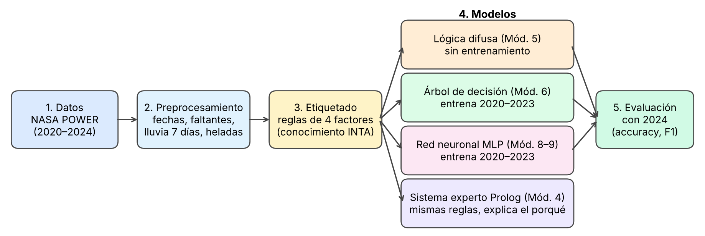
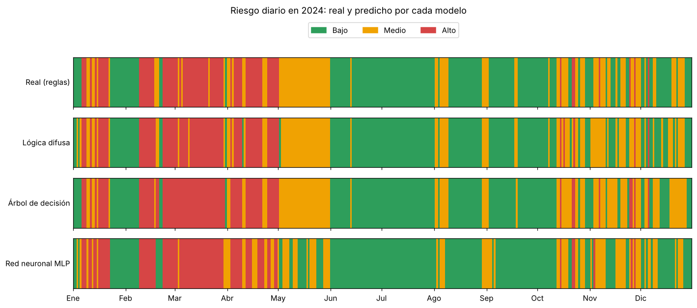

# Sistema de alerta temprana de plagas a partir de datos climáticos

[](https://colab.research.google.com/github/cabrerayam/sistema-alerta-temprana-plagas/blob/main/notebooks/TP_Integrador_Alerta_Plagas.ipynb)

Trabajo Práctico Integrador de **Inteligencia Artificial**, Facultad de Ingeniería, Universidad de Palermo (2026, cuatrimestre II).

El sistema estima, para cada día, el **nivel de riesgo (Bajo, Medio o Alto) de la chicharrita del maíz** (*Dalbulus maidis*) en Pergamino, provincia de Buenos Aires, usando solo datos climáticos públicos de NASA POWER. La chicharrita transmite el achaparramiento del maíz, que en la campaña 2023/24 causó pérdidas muy importantes en Argentina. Un aviso temprano permite reforzar el monitoreo y aplicar control preventivo a tiempo.

## Qué hace

1. **Descarga y prepara los datos** diarios 2020–2024 (temperatura, humedad, lluvia y radiación).
2. **Etiqueta cada día** con reglas basadas en la bibliografía: temperatura favorable, humedad alta, lluvia acumulada en 7 días e invierno previo benigno (pocas heladas fuertes). Con 3 o 4 factores el riesgo es Alto, con 2 es Medio y con 0 o 1 es Bajo.
3. **Compara tres técnicas** vistas en la materia, entrenando con 2020–2023 y probando con 2024:
   - **Lógica difusa** (Mamdani): usa el conocimiento experto con transiciones graduales, sin entrenamiento.
   - **Árbol de decisión**: aprende reglas a partir de los datos y se puede leer como un diagrama.
   - **Red neuronal MLP**: aprende una función no lineal con backpropagation.
4. **Sistema experto en Prolog** con las mismas reglas, que además explica por qué llega a cada conclusión y da una recomendación de manejo.



## Resultados (prueba con el año 2024)

| Modelo | Accuracy | F1 macro | Recall clase Alto |
|---|---|---|---|
| Lógica difusa | 0,940 | 0,936 | 0,952 |
| Árbol de decisión | 0,940 | 0,936 | 1,000 |
| Red neuronal MLP | 0,842 | 0,826 | 0,892 |
| *Referencia: siempre la clase más frecuente* | *0,49* | | |

- El árbol y la lógica difusa empatan, y el árbol no deja pasar ningún día de riesgo Alto. Además redescubre los umbrales de la regla, por eso es el más fácil de explicar.
- Las reglas marcan la campaña 2023/24, la del brote real, como la de más días de riesgo Alto, con la primera alerta a principios de septiembre de 2023. Tras las heladas del invierno 2024 el riesgo Alto casi desaparece, igual que lo observado en el campo.
- **Limitación:** sin las variables de la regla, el árbol cae a 0,59. Los modelos aprenden la regla experta, no la biología de la plaga; para ir más allá harían falta capturas reales de la plaga.



El análisis completo está en el [informe](docs/Informe_TP_Integrador.pdf) y en el [notebook](notebooks/TP_Integrador_Alerta_Plagas.ipynb).

## Estructura del repositorio

```
sistema-alerta-temprana-plagas/
├── README.md
├── LICENSE
├── requirements.txt
├── .gitignore
├── notebooks/
│   └── TP_Integrador_Alerta_Plagas.ipynb   # notebook completo, ya ejecutado
├── datos/
│   ├── crudos/
│   │   └── nasa_power_test.csv             # datos diarios 2020–2024 de NASA POWER
│   └── procesados/
│       └── dataset_riesgo_plagas.csv       # dataset con variables y etiqueta de riesgo
├── prolog/
│   └── sistema_experto_plagas.pl           # sistema experto (SWI-Prolog)
├── resultados/
│   └── resultados_comparacion.csv          # métricas de los tres modelos
├── figuras/                                # gráficos que genera el notebook
└── docs/
    └── Informe_TP_Integrador.pdf           # informe final del trabajo
```

## Cómo ejecutarlo

### Opción 1: Google Colab (sin instalar nada)

Hacer clic en el botón **Abrir en Colab** de arriba y elegir *Entorno de ejecución → Ejecutar todas*. Si el notebook no encuentra el CSV, lo descarga directamente de la API de NASA POWER. También se puede subir `datos/crudos/nasa_power_test.csv` al panel de archivos de Colab.

### Opción 2: en la computadora

Requiere Python 3.10 o superior.

```bash
git clone https://github.com/cabrerayam/sistema-alerta-temprana-plagas.git
cd sistema-alerta-temprana-plagas
python -m venv .venv
source .venv/bin/activate          # en Windows: .venv\Scripts\activate
pip install -r requirements.txt
cd notebooks
jupyter notebook TP_Integrador_Alerta_Plagas.ipynb
```

Al ejecutarlo desde `notebooks/`, el notebook lee los datos de `datos/crudos/` y guarda el dataset en `datos/procesados/`, las métricas en `resultados/` y los gráficos en `figuras/`.

### Sistema experto en Prolog

Requiere [SWI-Prolog](https://www.swi-prolog.org/).

```
cd prolog
swipl sistema_experto_plagas.pl
?- informe(dia_2024_03_15).
Dia: dia_2024_03_15
Factores favorables: [temperatura,humedad,lluvia,invierno_benigno]
Riesgo: alto
Recomendacion: control_preventivo_y_monitoreo_semanal
```

Otras consultas: `riesgo(dia_2024_07_10, R).` y `recomendacion(dia_2024_03_05, A).`

## Datos

- **Fuente:** NASA Langley Research Center, POWER Project, https://power.larc.nasa.gov/
- **Punto:** Pergamino, Buenos Aires (latitud −33,93, longitud −60,53), del 01/01/2020 al 31/12/2024.
- **Variables:** temperatura media, máxima y mínima a 2 m (T2M, T2M_MAX, T2M_MIN), precipitación (PRECTOTCORR), humedad relativa (RH2M) y radiación solar (ALLSKY_SFC_SW_DWN).
- Son datos públicos y no contienen información personal ni sensible.

## Tecnologías

Python, pandas, NumPy, Matplotlib, scikit-learn, scikit-fuzzy y SWI-Prolog.

## Licencia

El código se distribuye bajo la licencia MIT (ver [LICENSE](LICENSE)). Los datos climáticos pertenecen a NASA POWER y son de uso público.

## Autora

Yamileth Cabrera Rendón. Docente: Ignacio Casais.
